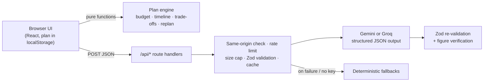

# Celebration Planner

A GenAI planning assistant for weddings, birthdays and community events. It builds a budget, a schedule in the right order and a vendor checklist from a short brief. When something changes, it **revises the plan instead of starting over**.

> PromptWars Virtual, Challenge 5: Celebration & Event Planner

## Who it's for

Families planning a celebration on a fixed budget, where the plan keeps moving. The guest list grows, the budget shrinks, the date shifts, a vendor's quote comes in higher than expected. Planning isn't one problem. It's a set of connected ones, and a change in one place has knock-on effects everywhere else. This app keeps those pieces in sync.

## Try the core scenario

1. Create a plan: a wedding, 200 guests, ₹8,00,000, about four months out, with food and photography as priorities.
2. In **Something changed?**, type: *"We now have 50 more guests, the budget dropped by 80k, and it's two weeks earlier."*
3. Preview, then apply. The plan revises in place:
   - catering and invitations rescale with headcount; confirmed prices are left alone
   - every open task is rescheduled against the new date, and a compressed schedule is flagged
   - the ₹1,50,000 gap is shown with four concrete trade-offs: absorb it in contingency, protect your priorities and trim the rest, invite fewer guests, or raise the budget. Each shows exactly what it costs you.
   - finished tasks and booked vendors are untouched

## What it does

| Brief requirement | How it's handled |
| --- | --- |
| **Budgets** | Splits the total across categories for the event type, checks per-guest catering against the experience level, rescales headcount-driven lines when guests change, and offers trade-offs when over budget. Every figure is labelled **Estimate** or **Confirmed**. |
| **Timelines** | Tasks are scheduled backwards from the event date, with dependencies (venue before caterer before menu). "Ready" marks what can be done now. Rescheduling a task pushes back everything that depends on it, while slack absorbs small slips. Short lead times compress the schedule proportionally. |
| **Vendor checklists** | Prepares what to ask each type of vendor, records vendors and quotes, and structures pasted quotes into a side-by-side comparison (inclusions, extra charges, what to clarify). Booking a vendor confirms its price in the budget and completes the matching task. |
| **Personalised ideas** | Concepts grounded in guest ages, culture, dietary and accessibility notes, each sized against your own budget line. Push back ("too expensive", "needs to work for kids and grandparents") and they're reworked. |

## How GenAI is used, and where it isn't

The design rule is **AI proposes, the engine does the maths.** Language understanding and creative work go to an LLM. Arithmetic, scheduling and anything that has to be correct every time is deterministic TypeScript, tested and run in the browser with no API cost.

| Feature | Model tier | What the model does |
| --- | --- | --- |
| Interpret a brief or a change | Lite | Turns plain language into a structured patch ("two weeks earlier" becomes a date) and asks a clarifying question when something is vague. The user confirms before anything changes. |
| Personalised ideas | Smart | Generates and refines concepts with estimated cost ranges and stated assumptions. |
| Vendor preparation | Lite | Requirements, questions to ask and common hidden costs for a vendor type. |
| Quote comparison | Lite | Extracts pasted quotes into a fixed structure. |

Two providers are supported behind one interface (`src/lib/ai/llm.ts`). Whichever key is set is used; set `AI_PROVIDER` to choose when both are.

| Provider | Smart | Lite | Structured output |
| --- | --- | --- | --- |
| Google Gemini | `gemini-3.8-flash` | `gemini-3.5-flash-lite` | `responseJsonSchema` |
| Groq | `openai/gpt-oss-120b` | `openai/gpt-oss-20b` | Strict JSON schema (constrained decoding) |

All model output is requested as JSON against a schema derived from the same Zod contracts that validate requests. Providers accept different schema keywords, so length and format limits are sent as plain-language hints. The reply is trimmed to those limits and **re-validated with Zod** before use.

### Honesty guardrails

- Budget figures from planning assumptions or AI are always marked **Estimate**. Only a price the user records from a real vendor becomes **Confirmed**, and confirmed prices are never rescaled or cut automatically.
- The model is instructed never to invent vendors, contact details, availability or prices.
- Idea estimates are **totalled by the app from an itemised breakdown** the model provides, so a headline figure can never contradict its own parts. Categories already booked are left out of suggestions.
- Quote comparison **drops any figure that doesn't appear in the quote text** and tells the user to confirm it (`src/lib/ai/guards.ts`). Totals calculated from per-guest prices are labelled "calculated".
- Every AI result is labelled **AI suggestion** or **Built-in suggestion**.

### Works without a key

With no provider key, the interpreter, ideas and vendor questions fall back to deterministic built-ins (clearly labelled), so the whole budget, timeline and replanning flow still works. Quote comparison is the one feature that refuses rather than guesses.

## Architecture



```
src/
  app/                 Next.js App Router: page, layout, API routes
  components/          UI panels (intake, change, budget, timeline, vendors, ideas)
  lib/domain/          Plan engine: pure, framework-free, fully unit-tested
  lib/ai/              Contracts, prompts, provider clients, guards, fallbacks
  lib/server/          Route factory, rate limiter, response cache
  lib/client/          Plan persistence and request hooks
```

## Running it

Requires Node 22.12+.

```bash
npm install
cp .env.example .env.local   # add GEMINI_API_KEY or GROQ_API_KEY to enable AI features
npm run dev                  # http://localhost:3000
```

| Command | Purpose |
| --- | --- |
| `npm test` | Unit and route tests (Vitest) |
| `npm run typecheck` | Strict TypeScript |
| `npm run lint` | ESLint with Next.js, React Hooks and jsx-a11y rules |
| `npm run build` | Production build (standalone output) |

### Deploying to Cloud Run

```bash
gcloud run deploy celebration-planner \
  --source . \
  --region asia-south1 \
  --allow-unauthenticated \
  --set-secrets GEMINI_API_KEY=gemini-api-key:latest
```

For Groq, use `--set-secrets GROQ_API_KEY=groq-api-key:latest` instead. Store keys in Secret Manager; they are only read on the server.

## Quality notes

**Security.** API keys are server-only (`server-only` import, never `NEXT_PUBLIC_`). Every request body is size-capped and validated with Zod. Cross-site browser requests are refused, and each client is rate-limited. User text is fenced as data in prompts, and model output is schema-checked. Responses carry a Content-Security-Policy and other security headers. User content is never logged.

**Efficiency.** Budget, scheduling and replanning run client-side with zero API calls. The model is only called on an explicit action. Extraction uses the lite model and generation uses the larger one. Identical requests are cached for 10 minutes. Calls time out at 20–30 seconds, and only malformed replies are retried, once.

**Testing.** The domain engine, fallbacks, guards, rate limiter and route handlers are covered, including the full replan scenario above as a single test (`src/lib/domain/plan.test.ts`).

**Accessibility.** Semantic landmarks and headings, a skip link, labelled controls, fieldsets for grouped choices, an error summary that receives focus, live regions for AI results and plan changes, visible focus rings, 44px touch targets, status shown in text (not colour alone), WCAG AA contrast in light and dark themes, and no horizontal scrolling at 375px.

## Limitations

- Plans are stored in the browser only, so there is no sharing or sync across devices.
- The rate limiter and cache are per server instance.
- Budget weights and per-guest assumptions are illustrative starting points (`src/lib/domain/assumptions.ts`), not market data.
