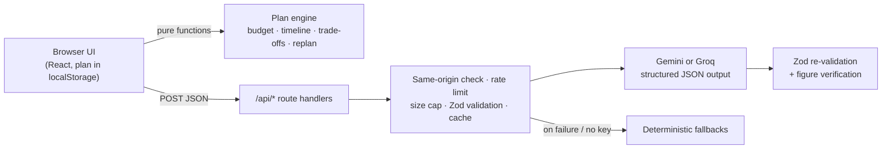

# Celebration Planner

[](https://github.com/desilva23/celebration-planner/actions/workflows/ci.yml)

**Live:** https://celebration-planner-jade.vercel.app

A GenAI planning assistant for weddings, birthdays and community events. It builds a budget, a schedule in the right order and a vendor checklist from a short brief. When something changes, it **revises the plan instead of starting over**.

> PromptWars Virtual, Challenge 5: Celebration & Event Planner

## Who it's for

Families planning a celebration on a fixed budget, where the plan keeps moving. The guest list grows, the budget shrinks, the date shifts, a vendor's quote comes in higher than expected. Planning isn't one problem. It's a set of connected ones, and a change in one place has knock-on effects everywhere else. This app keeps those pieces in sync.

## Try the core scenario

1. Create a plan: a wedding, 200 guests, ₹8,00,000, about four months out, with food and photography as priorities.
2. In **Something changed?**, type: *"We now have 50 more guests, the budget dropped by 80k, and it's two weeks earlier."*
3. Preview, then apply. The plan revises in place:
   - catering and invitations rescale with headcount; confirmed prices are left alone
   - every open task is rescheduled against the new date, and a compressed schedule is flagged
   - the ₹1,50,000 gap is shown with four concrete trade-offs: absorb it in contingency, protect your priorities and trim the rest, invite fewer guests, or raise the budget. Each shows exactly what it costs you.
   - finished tasks and booked vendors are untouched
4. Choose a trade-off. Every reported change can be undone from the notice that reports it, as long as nothing has changed since.

## What it does

| Brief requirement | How it's handled |
| --- | --- |
| **Budgets** | Splits the total across categories for the event type, checks per-guest catering against the experience level, rescales headcount-driven lines when guests change, and offers trade-offs when over budget. Every figure is labelled **Estimate** or **Confirmed**. |
| **Timelines** | Tasks are scheduled backwards from the event date, with dependencies (venue before caterer before menu). "Ready" marks what can be done now. Rescheduling a task pushes back everything that depends on it, while slack absorbs small slips. Short lead times compress the schedule proportionally. |
| **Vendor checklists** | Prepares what to ask each type of vendor, records vendors and quotes, and structures pasted quotes into a side-by-side comparison (inclusions, extra charges, what to clarify). Booking a vendor confirms its price in the budget and completes the matching task. A category can have several bookings (a caterer and a sweets stall), and cancelling one turns the line back into an estimate and reopens the task. |
| **Payments** | Each booking can carry a schedule of advances and balances with due dates. Overdue and next payments are shown at the top of the plan, and the budget shows how much is paid. |
| **Guests** | Invitations by household or group, with how many people and their reply. When everyone who hasn't declined differs from the plan's headcount, one click re-plans for that number. |
| **On the day** | A run sheet for the day itself, drafted from the plan and the time guests arrive: what happens when, who looks after each step, and reminders. It copies as plain text to send to family and vendors. |
| **Personalised ideas** | Concepts grounded in guest ages, culture, dietary and accessibility notes, each sized against your own budget line. Push back ("too expensive", "needs to work for kids and grandparents") and they're reworked. |
| **Keeping a plan** | Download the plan as a file and open it on another device, share a link that opens a copy (without the guest list, which names real people), or add the event day, task deadlines and unpaid payments to a calendar (.ics). |

## How GenAI is used, and where it isn't

The design rule is **AI proposes, the engine does the maths.** Language understanding and creative work go to an LLM. Arithmetic, scheduling and anything that has to be correct every time is deterministic TypeScript, tested and run in the browser with no API cost.

| Feature | Model tier | What the model does |
| --- | --- | --- |
| Interpret a brief or a change | Lite | Turns plain language into a structured patch ("two weeks earlier" becomes a date) and asks a clarifying question when something is vague. The user confirms before anything changes. |
| Personalised ideas | Smart | Generates and refines concepts with estimated cost ranges and stated assumptions. |
| Vendor preparation | Lite | Requirements, questions to ask and common hidden costs for a vendor type. |
| Quote comparison | Lite | Extracts pasted quotes into a fixed structure. |
| Run sheet | Smart | Drafts the day's timetable. Each step can only be assigned to a booked vendor or a generic role (hosts, family, venue staff, everyone): the schema sent with each request lists exactly those names. |

Two providers are supported behind one interface (`src/lib/ai/llm.ts`). Whichever key is set is used; set `AI_PROVIDER` to choose when both are.

| Provider | Smart | Lite | Structured output |
| --- | --- | --- | --- |
| Google Gemini | `gemini-3.8-flash` | `gemini-3.5-flash-lite` | `responseJsonSchema` |
| Groq | `openai/gpt-oss-120b` | `openai/gpt-oss-20b` | Strict JSON schema (constrained decoding) |

All model output is requested as JSON against a schema derived from the same Zod contracts that validate requests. Providers accept different schema keywords, so length and format limits are sent as plain-language hints. The reply is trimmed to those limits and **re-validated with Zod** before use.

### Honesty guardrails

- Budget figures from planning assumptions or AI are always marked **Estimate**. Only a price the user records from a real vendor becomes **Confirmed**, and confirmed prices are never rescaled or cut automatically.
- The model is instructed never to invent vendors, contact details, availability or prices.
- Idea estimates are **totalled by the app from an itemised breakdown** the model provides, so a headline figure can never contradict its own parts. Categories already booked are left out of suggestions.
- Quote comparison **drops any figure that doesn't appear in the quote text** and tells the user to confirm it (`src/lib/ai/guards.ts`). Totals calculated from per-guest prices are labelled "calculated".
- Every AI result is labelled **AI suggestion** or **Built-in suggestion**.

### Works without a key

With no provider key, the interpreter, ideas, vendor questions and run sheet fall back to deterministic built-ins (clearly labelled), so the whole budget, timeline and replanning flow still works. Quote comparison is the one feature that refuses rather than guesses.

## Architecture



```
src/
  app/                 Next.js App Router: page, layout, error screen, API routes
  components/          UI panels (intake, change, budget, timeline, run sheet, vendors, guests, ideas)
  lib/domain/          Plan engine: pure, framework-free, fully unit-tested
  lib/ai/              Contracts, prompts, provider clients, guards, fallbacks
  lib/server/          Route factory, rate limiter, response cache, CSP
  lib/client/          Plan persistence, plan files and share links, request hooks
  proxy.ts             Per-request Content-Security-Policy nonce
e2e/                   Browser tests (Playwright) against the production server
```

## Running it

Requires Node 22 (pinned in `.nvmrc` and `package.json`, the same version CI, Vercel and the Docker image use).

```bash
npm install
cp .env.example .env.local   # add GEMINI_API_KEY or GROQ_API_KEY to enable AI features
npm run dev                  # http://localhost:3000
```

| Command | Purpose |
| --- | --- |
| `npm test` | Unit, route and component tests (Vitest) |
| `npm run test:coverage` | Tests plus a coverage report in `coverage/`; fails below 100% |
| `npm run test:e2e` | Builds, then runs the browser tests in Chromium (Playwright). First time: `npx playwright install chromium` |
| `npm run test:mutation` | Mutation testing of `src/lib` (Stryker); report in `reports/mutation/` |
| `npm run typecheck` | Strict TypeScript |
| `npm run lint` | ESLint with Next.js, React Hooks, jsx-a11y and type-aware TypeScript rules |
| `npm run format` | Prettier (`format:check` only reports) |
| `npm run check` | Formatting, lint, typecheck and tests with coverage, as CI runs them |
| `npm run build` | Production build (standalone output) |

### Deploying to Vercel

The repository is connected to a Vercel project: every push to `main` deploys to production and every pull request gets a preview deployment. `main` only takes changes whose CI checks have passed.

In the project's settings, add environment variables for Production (and Preview, if previews should use AI too):

| Variable | Needed? | Purpose |
| --- | --- | --- |
| `GEMINI_API_KEY` or `GROQ_API_KEY` | For AI features | Without one, the built-in suggestions are used. Keys are only read on the server. |
| `AI_PROVIDER` | Only if both keys are set | `gemini` or `groq` |
| Upstash Redis | Recommended | Install **Upstash for Redis** from the Vercel Marketplace and connect it to the project. Its `KV_REST_API_URL` and `KV_REST_API_TOKEN` are picked up automatically (or set `UPSTASH_REDIS_REST_URL` and `UPSTASH_REDIS_REST_TOKEN`). Without it, the rate limit and cache are per function instance, which on Vercel are many and short-lived. |

Leave `TRUSTED_PROXY_HOPS` unset: Vercel replaces `X-Forwarded-For` with the client's address, so the default of 1 is right. Functions run in Mumbai (`bom1`, set in `vercel.json`), close to the people the planner is for; change it there if your users are elsewhere. The Node version comes from `engines` in `package.json` (22.x), the same as CI.

### Running it in a container

The `Dockerfile` builds the standalone server for any container host, such as Cloud Run. Set the same variables, and set `TRUSTED_PROXY_HOPS=2` behind an external Google Cloud load balancer, which adds its own address after the client's.

## Quality

### Problem statement alignment

The brief asks for help with budgets, timelines, vendor checklists and personalised ideas; [What it does](#what-it-does) maps each to how it's handled, and [Try the core scenario](#try-the-core-scenario) shows them working together when the plan changes. GenAI is used where language or creativity is the job, and kept away from anything that has to add up ([How GenAI is used](#how-genai-is-used-and-where-it-isnt)). Beyond the brief: guests and RSVPs, vendor payments, a day-of run sheet, and plans you can download, share or add to a calendar.

### Code quality

Strict TypeScript, including `noUncheckedIndexedAccess`, `noUnusedLocals` and `noUnusedParameters`. ESLint (Next.js, React Hooks, jsx-a11y and type-aware TypeScript rules) allows no warnings and keeps every unit small: cyclomatic complexity at most 10, functions at most 80 lines, files at most 300, nesting at most 3 deep and at most 4 parameters. Prettier formats everything, and Knip fails the build on unused files, exports or dependencies. A jscpd scan finds no duplicated code. The plan engine (`src/lib/domain`) is pure and framework-free; the same Zod contracts validate requests, describe the JSON the model must return, and check what it did return.

Every plan operation checks its result against the same schema used to load saved plans, so no change can store a plan that would fail to load next time. Out-of-range input is refused with a plain-language reason instead. A saved plan that still can't be read, such as one saved by a different version, is set aside rather than discarded, and the user is offered a download. If the page fails to render, an error screen offers to try again or to start over with the plan kept.

### Security

API keys are server-only (`server-only` import, never `NEXT_PUBLIC_`). Every request body is size-capped while it is read, so even an upload that never states its size stops at 32 KB, and is validated with Zod. Cross-site browser requests are refused, and each client is rate-limited by the address your own proxy recorded, not one the client can forge (`TRUSTED_PROXY_HOPS`). User text is fenced as data in prompts, and model output is schema-checked. Pages get a strict Content-Security-Policy with a fresh nonce on every request (`src/proxy.ts`), so injected inline scripts, event handlers and styles never run, plus other security headers. Nothing needs `eval`: Zod is configured not to compile parsers with it (`src/lib/zod.ts`). Share links carry the plan in the URL fragment, which browsers never send to a server. User content is never logged.

CodeQL scans every push and pull request, Dependabot proposes updates weekly, `npm audit` reports no vulnerabilities, and [SECURITY.md](SECURITY.md) explains how to report a problem privately.

### Efficiency

Budget, scheduling and replanning run client-side with zero API calls. The model is only called on an explicit action. Extraction uses the lite model and generation uses the larger one. Identical requests are cached for 10 minutes, in memory or in Upstash Redis when it is configured. Calls time out at 20–30 seconds, and only malformed replies are retried, once.

Lighthouse on the live site scores Performance 96 on throttled mobile and 100 on desktop, with Largest Contentful Paint at 2.2 s and 0.5 s and no layout shift.

### Testing

Statements, branches, functions and lines are all at 100% across `src/`, and the run fails if any of them drops (`vitest.config.mts`). Domain, AI and server code is tested in Node. Components and browser storage are tested in jsdom with Testing Library, driven through labels and roles as a user would, and each panel is checked with axe for accessibility problems. The full replan scenario above is a single test (`src/lib/domain/plan.test.ts`). The built-in fallbacks are held to the same Zod contracts as the model, and plan operations are tested for purity.

Browser tests (`e2e/`, Playwright) run the production build in Chromium with AI off: building, revising and undoing a plan, the run sheet, share links opened in a second browser, and plan files opened on "another device". Every browser test fails if the page logs an error or a CSP violation. They also check the CSP itself (a fresh nonce on every script, injected markup refused), run every axe rule including colour contrast in light and dark themes, and check that nothing scrolls sideways at 320px.

Coverage only shows that code ran. Mutation testing (`stryker.config.mjs`) shows whether the tests would notice if it were wrong: Stryker makes thousands of small changes to `src/lib`, such as flipping a comparison, and checks that a test fails for each. It scores over 99%, and the run fails below 97%. The report the workflow uploads shows every mutant that survives.

CI (`.github/workflows/ci.yml`) runs formatting, lint, Knip, typecheck, tests with coverage, a production build and the browser tests on every push and pull request, and `main` only accepts changes that pass. Mutation testing runs weekly (`mutation.yml`), and Dependabot proposes dependency and action updates every week.

### Accessibility

Semantic landmarks and headings, a skip link, labelled controls, fieldsets for grouped choices, an error summary that receives focus, live regions for AI results and plan changes, visible focus rings, 44px touch targets, status shown in text (not colour alone), WCAG AA contrast in light and dark themes, and no horizontal scrolling at 320px (WCAG reflow). Contrast and reflow are checked in a real browser on every pull request. Lighthouse scores Accessibility 100 on mobile and desktop.

## Limitations

- There are no accounts. A plan lives in the browser that made it; it can be downloaded, opened elsewhere or shared as a link, but copies don't stay in sync.
- The rate limiter and cache are per server instance unless Upstash Redis is configured, which shares them across instances. If Redis is unreachable, requests are still served and the failure is logged.
- Budget weights and per-guest assumptions are illustrative starting points (`src/lib/domain/assumptions.ts`), not market data.

## License

[MIT](LICENSE)
